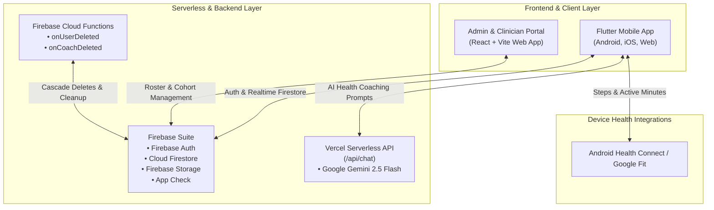

# DiaPrevent (DPPHealis) — Codebase Documentation & Architecture Guide

> **Project Name:** DiaPrevent / DPPHealis (`dpp_app`)  
> **Platform Support:** Flutter (Android, iOS, Web, Desktop), React Web Admin, Vercel Serverless AI Backend, Firebase Cloud Infrastructure  
> **Target Audience:** Prediabetes / Type 2 Diabetes At-Risk Individuals, Lifestyle Coaches, Clinical Administrators  

---

## 📖 Table of Contents

1. [Executive Overview & System Architecture](#1-executive-overview--system-architecture)
2. [High-Level Directory Structure](#2-high-level-directory-structure)
3. [Root Configuration & Utility Scripts](#3-root-configuration--utility-scripts)
4. [Flutter Core Application (`lib/`)](#4-flutter-core-application-lib)
   - [4.1 Root Files](#41-root-files)
   - [4.2 Data Layer (`lib/data/`)](#42-data-layer-libdata)
   - [4.3 Domain Models & Business Logic (`lib/models/`)](#43-domain-models--business-logic-libmodels)
   - [4.4 State Management & Notifiers (`lib/providers/`)](#44-state-management--notifiers-libproviders)
   - [4.5 Repositories (`lib/repositories/`)](#45-repositories-librepositories)
   - [4.6 Screens & User Interfaces (`lib/screens/`)](#46-screens--user-interfaces-libscreens)
   - [4.7 Services & Background Engines (`lib/services/`)](#47-services--background-engines-libservices)
   - [4.8 Theme & Styling (`lib/theme/`)](#48-theme--styling-libtheme)
   - [4.9 Interactive In-App Tour (`lib/tour/`)](#49-interactive-in-app-tour-libtour)
   - [4.10 Reusable UI Widgets (`lib/widgets/`)](#410-reusable-ui-widgets-libwidgets)
   - [4.11 Custom Canvas Painters (`lib/painters/`)](#411-custom-canvas-painters-libpainters)
5. [Web Clinical Admin Panel (`admin-panel/`)](#5-web-clinical-admin-panel-admin-panel)
6. [AI Coaching Backend (`vercel_ai_backend/`)](#6-ai-coaching-backend-vercel_ai_backend)
7. [Cloud Functions for Firebase (`firebase_functions/`)](#7-cloud-functions-for-firebase-firebase_functions)
8. [Assets, Data & Media Directories (`assets/`, `food_images/`, `FFQ/`)](#8-assets-data--media-directories)
9. [Test Suite (`test/`)](#9-test-suite-test)
10. [Native Platform Projects (`android/`, `ios/`, etc.)](#10-native-platform-projects)
11. [Supplementary, Integration & Scratch Folders](#11-supplementary-integration--scratch-folders)
12. [Core Workflows & Data Flows](#12-core-workflows--data-flows)

---

## 1. Executive Overview & System Architecture

**DiaPrevent (DPPHealis)** is an enterprise-grade digital health application built around the National Diabetes Prevention Program (NDPP) evidence-based behavioral change curriculum, specifically contextualized for Indian dietary, lifestyle, and genetic risk patterns.

### Core Pillars
- **Validated Clinical Assessments:**
  - **IDRS (Indian Diabetes Risk Score):** Stratifies Type 2 diabetes risk based on age, waist circumference, physical activity, and family history.
  - **GPAQ (Global Physical Activity Questionnaire):** Evaluates occupational, transport, and leisure physical activity into MET-minutes.
  - **FFQ (Food Frequency Questionnaire):** Measures habitual consumption across Indian food categories.
- **Daily Behavioral Tracking:**
  - **Nutrition & Energy Balance:** Calorie, carb, protein, and fat tracking powered by the Indian Food Composition Tables (IFCT 2017) and an extensive Indian recipe database.
  - **Activity & Step Sync:** Automatic physical activity tracking through Android Health Connect / Google Fit / Apple Health alongside manual activity logging.
  - **Weekly Weigh-Ins:** Tracks progressive movement toward the landmark NDPP goal of 5–7% body weight reduction.
- **Interactive DPP Curriculum:**
  - 16 core weekly sessions + maintenance sessions with integrated video lessons, skeuomorphic antique manuscript notes, and gamified retro pixel-art journey progression.
- **Hybrid Care Delivery:**
  - **AI Health Coach:** 24/7 conversational coaching powered by Google Gemini (gemini-2.5-flash) with strict clinical guardrails.
  - **Human Lifestyle Coaches & Clinicians:** Real-time 1-on-1 messaging and cohort management through a dedicated React Web Admin portal.



---

## 2. High-Level Directory Structure

```text
DPP/
├── admin-panel/              # React + Vite web dashboard for clinicians and admins
├── android/                  # Native Android platform code and Health Connect manifests
├── assets/                   # Static application images, logos, and nutrition CSVs
│   ├── data/                 # Processed Indian food nutrition CSV database
│   └── images/               # App icons, avatars, FFQ illustrations, session graphics
├── code_files/               # Archived modular component blueprints
├── docs/                     # Specifications and walkthrough guides (App Tour, etc.)
├── FFQ/                      # Food Frequency Questionnaire clinical reference document
├── firebase_functions/       # Cloud Functions for cascade deletes and background triggers
├── food_images/              # 100+ high-resolution photographs of Indian dishes
├── ios/                      # Native iOS platform configuration and Podfile
├── lib/                      # Core Flutter source code (screens, services, models, data)
├── linux/                    # Native Linux desktop runner
├── macos/                    # Native macOS desktop runner
├── scratch/                  # Maintenance and refactoring scripts
├── test/                     # Automated unit, widget, and integration test suite
├── vercel_ai_backend/        # Node.js Vercel serverless proxy for Gemini AI chat
├── vid_integration_files/    # Video integration reference files & progress tests
├── web/                      # Flutter Web runner, HTML container, and PWA manifest
├── windows/                  # Native Windows desktop runner
└── [Root configuration and utility scripts]
```

---

## 3. Root Configuration & Utility Scripts

| File | Purpose / Description |
| :--- | :--- |
| `pubspec.yaml` | Flutter package manifest defining app version, SDK constraints (`>=3.0.0 <4.0.0`), production dependencies (Firebase, fl_chart, health, webview, speech_to_text, etc.), and asset bundle paths. |
| `pubspec.lock` | Pinned dependency tree lockfile ensuring deterministic Flutter builds. |
| `analysis_options.yaml` | Dart analyzer configuration enforcing code quality and `flutter_lints` rules. |
| `firestore.rules` | Security rules for Cloud Firestore enforcing granular access controls: patients can read/write their own logs, chats, and profiles, while authorized `@healis.org` clinical admins can read patient cohorts. |
| `firebase.json` | Project configuration mapping Firebase services (Cloud Firestore, Cloud Functions, and Hosting targets). |
| `seed_firestore.py` | Python migration script using `firebase-admin` to seed initial foods from `Indian_Food_Nutrition_Processed.csv` into the Firestore `foods` collection. |
| `upload_foods.py` | Batch upload utility merging IFCT raw ingredient tables with processed dish datasets into Cloud Firestore while preventing duplicate entries. |
| `generate_db.py` | Python script aggregating Indian food nutrition tables and FFQ Excel files to generate Dart constants. |
| `generate_db.dart` | Standalone Dart script parsing `assets/data/Indian_Food_Nutrition_Processed.csv` directly into the offline in-memory map `lib/data/nutrition_database.dart`. |
| `clean_dashboard.dart` | Refactoring utility script used to extract legacy tour logic out of `dashboard_screen.dart` into the dedicated `lib/tour/` architecture. |
| `update_manuscript.py` | Script used to apply 3D transformation matrices and desk padding to the manuscript curriculum reader. |
| `remove_bg.py` | Utility leveraging PIL/Pillow to remove black backgrounds from analysis graphics and generate transparent PNG assets. |
| `goal_journey_1fdb321.dart` | Milestone snapshot backup of the goal journey path implementation. |
| `pixels.txt` | Pixel-art coordinate mapping, layout coordinates, and node specs for retro adventure map rendering. |
| `test.dart` | Temporary test execution stub for running isolated Dart snippets. |
| `logcat.txt` & `logcat_dump.txt` | Android runtime logcat diagnostic captures for troubleshooting Health Connect and permissions. |
| `README.md` | Top-level project repository readme. |
| `.gitignore` | Git exclusion rules ignoring build outputs, `.dart_tool`, IDE configs, and secrets. |
| `.vercelignore` | Deployment filter preventing unnecessary files from uploading to Vercel serverless environments. |

---

## 4. Flutter Core Application (`lib/`)

The `lib/` directory houses the entire client-side Flutter application, engineered using a clean, layered architecture:

```text
lib/
├── firebase_options.dart
├── main.dart
├── secrets.dart
├── widgets.dart
├── data/              # Static catalogs, databases, palettes, and global app state
├── models/            # Domain entities, validation, and calculation formulas
├── painters/          # Custom Canvas rendering painters
├── providers/         # StateNotifier and ChangeNotifier state controllers
├── repositories/      # Data access layer interfacing Firestore and local storage
├── screens/           # Application views organized by user workflow
├── services/          # Business logic, hardware APIs, AI, and background sync
├── theme/             # Custom skeuomorphic and UI themes
├── tour/              # Interactive onboarding tour overlay system
└── widgets/           # Modular reusable UI components
```

---

### 4.1 Root Files

- **`lib/main.dart`**:  
  The main entry point of the Flutter mobile app. Initializes Firebase (`Firebase.initializeApp`), sets up multi-provider state management (`AppState`, `FoodNotifiers`, `SessionNotifiers`), initializes local notifications, loads sound and TTS services, and configures the `MaterialApp` with dynamic routing (routing between `SplashScreen`, `LoginScreen`, `DashboardScreen`, and risk assessment flows).

- **`lib/firebase_options.dart`**:  
  Auto-generated configuration file by FlutterFire CLI containing platform-specific Firebase API keys, project IDs, and storage buckets for Android, iOS, macOS, and Web.

- **`lib/secrets.dart`**:  
  Houses sensitive endpoint configuration, including Gemini API access keys, Vercel backend base URLs, and environment flags.

- **`lib/widgets.dart`**:  
  Barrel export utility consolidating common UI widget imports across the project.

---

### 4.2 Data Layer (`lib/data/`)

| File | Purpose / Description |
| :--- | :--- |
| `app_state.dart` | Central `ChangeNotifier` managing global user state: active user profile, cached IDRS/GPAQ scores, daily streaks, accumulated reward points, active curriculum week, and user preferences. |
| `dpp_session_videos.dart` | Comprehensive curriculum video registry for all 16 core DPP sessions plus maintenance modules. Maps YouTube video IDs, titles, descriptions, runtimes, key takeaways, and reflection prompts. |
| `FFQ (1).xlsx` | Standardized Food Frequency Questionnaire Excel sheet containing major food categories, item names, portion units, and nutrient multiplier coefficients. |
| `gelato_theme.dart` | Design system defining the signature **Gelato Neobrutalist** visual identity: pastel palette (mint green, vanilla yellow, strawberry pink, sky blue, lavender purple, peach orange), bold 2.0px–2.5px solid borders, and 3px offset drop shadows. |
| `handouts_data.dart` | Curated catalog of educational DPP handouts, nutritional guidelines, exercise safety tips, and printable participant worksheets. |
| `ifct2017_compositions.csv` | Official Indian Food Composition Tables (IFCT 2017) raw nutritional database with detailed per-100g breakdowns of energy, protein, carbohydrates, fats, dietary fiber, minerals, and vitamins. |
| `journey_data.dart` | Configuration data for the gamified curriculum journey map, detailing chapter milestones, level requirements, node positions, and unlock conditions. |
| `nutrition_database.dart` | Pre-compiled, in-memory Dart hash map mapping hundreds of common Indian dishes directly to calorie counts for instantaneous autocomplete and offline searching. |

---

### 4.3 Domain Models & Business Logic (`lib/models/`)

- **`activity_goal_logic.dart`**: Contains the business logic governing physical activity progression: evaluates whether a workout meets "qualifying session" criteria (e.g., 10+ minutes of moderate/vigorous intensity) and updates daily streak counters.
- **`activity_log.dart`**: Domain model representing a single physical activity event (activity type, duration in minutes, MET score, calculated calories burned, manual vs. health synced flag, timestamp).
- **`activity_stats.dart`**: Aggregated performance model summarizing today's active minutes, weekly cumulative progress towards the 150-minute NDPP target, and streak velocity.
- **`calorie_goal_calculator.dart`**: Implements clinically validated formulas calculating daily basal metabolic rate (BMR), total daily energy expenditure (TDEE), and personalized daily caloric deficits targeting a healthy 5–7% weight loss.
- **`chat_message.dart`**: Data model representing chat communication between patient and clinician/coach or the AI Assistant (message text, sender ID, role, timestamp, attachment URLs).
- **`coach_profile.dart`**: Represents clinician/coach entities (name, credentials, specialty, biography, avatar image, active patient caseload).
- **`dpp_session_video.dart`**: Model encapsulating video lesson metadata, playback timestamps, progress percentage, and session completion flags.
- **`energy_balance_model.dart`**: Mathematical model computing net energy balance: $\text{Calories Consumed} - (\text{BMR} + \text{Activity Burn})$, providing visual calorie deficit/surplus states.
- **`food_item.dart`**: Model representing an individual food item or recipe, including serving unit options (cup, katori, piece, grams) and complete macronutrient profiles.
- **`food_log.dart`**: Represents a daily food intake record organized by meal slots (Breakfast, Lunch, Dinner, Snacks) with aggregated totals for calories, carbs, protein, and fat.
- **`ndpp_constants.dart`**: Clinical constant definitions based on the CDC National Diabetes Prevention Program: 150 minutes/week moderate activity goal, 5–7% body weight loss targets, and risk scoring boundaries.
- **`week_model.dart`**: Data model for a curriculum week module, containing learning objectives, session status (locked, current, completed), and unlock dependencies.

---

### 4.4 State Management & Notifiers (`lib/providers/`)

- **`food_notifiers.dart`**: `ChangeNotifier` orchestrating meal logging state: handles adding/removing food items, real-time recalculation of daily macronutrients, meal date switching, and food search filter states.
- **`journal_launcher.dart`**: Navigation helper and state bridge coordinating transitions between the curriculum video player and the skeuomorphic interactive notes journal.
- **`session_notifiers.dart`**: Manages curriculum progression state: tracks completed session videos, updates module lock states, records quiz/handout interactions, and persists curriculum milestones to Firestore.

---

### 4.5 Repositories (`lib/repositories/`)

- **`activity_log_repository.dart` & `activity_log_repository_impl.dart`**:  
  Abstract interface and concrete implementation managing physical activity records. Interacts with Firestore subcollections (`users/{uid}/activity_logs`) with local fallback and caching.
- **`activity_repository.dart` & `activity_repository_impl.dart`**:  
  Handles synchronization between device health sensors (Health Connect) and backend databases, aggregating raw step/minute records into cohesive daily stats.
- **`chat_repository.dart`**:  
  Handles real-time Firestore message streams (`chats/{uid}/messages`), sending outgoing messages, updating read receipts, and subscribing to unread counters.
- **`food_repository.dart`**:  
  Queries local IFCT datasets and the remote Firestore `foods` catalog; saves and fetches user meal logs from `logs/{userId}/food_entries`.

---

### 4.6 Screens & User Interfaces (`lib/screens/`)

The screens cover the complete user lifecycle from authentication to clinical risk scoring, habit logging, education, and clinician collaboration.

#### Authentication & Onboarding
- **`splash_screen.dart`**: Initial launch animation; verifies Firebase Auth state, checks whether baseline assessments are completed, and routes to `LoginScreen` or `DashboardScreen`.
- **`login_screen.dart`**: Clean sign-in screen supporting email/password, clinician detection, error handling, and redirection.
- **`signup_screen.dart`**: Registration view collecting basic demographics (name, age, gender) and bootstrapping the user's Firestore profile.
- **`forgot_password_screen.dart`**: Password reset request interface triggering Firebase Auth recovery emails.
- **`taste_preferences_screen.dart`**: Onboarding survey capturing food preferences (vegetarian, eggetarian, non-veg, vegan), regional dietary patterns, spice preferences, and food allergies.

#### Risk Assessment & Clinical Profiling
- **`risk_assessment_step1_screen.dart`**: Step 1 of IDRS: Age bracket selection and abdominal waist circumference measurement inputs.
- **`risk_assessment_step2_screen.dart`**: Step 2 of IDRS: Physical activity grading (vigorous, moderate, sedentary) and parental history of Type 2 diabetes.
- **`idrs_score_card_screen.dart`**: Dedicated scorecard detailing the Indian Diabetes Risk Score (<30: Low, 30–50: Moderate, ≥60: High) with clinical explanations.
- **`gpaq_step1_screen.dart`**: Part 1 of the Global Physical Activity Questionnaire: Occupational activity (vigorous/moderate work exertion).
- **`gpaq_step2_screen.dart`**: Part 2 of GPAQ: Transport activity (walking and bicycling habits to commute).
- **`gpaq_step3_screen.dart`**: Part 3 of GPAQ: Recreational/leisure-time sports, fitness, and exercise.
- **`gpaq_step4_screen.dart`**: Part 4 of GPAQ: Daily sedentary time (hours sitting/reclining per day).
- **`gpaq_score_card_screen.dart`**: Summarizes total MET-minutes/week and classifies overall activity into High, Moderate, or Low.
- **`gpaq_results_screen.dart`**: Detailed breakdown of GPAQ activity across domains (Work vs. Transport vs. Recreation).
- **`risk_assessment_result_screen.dart`**: Comprehensive unified report combining IDRS risk and GPAQ fitness results with personalized DPP lifestyle recommendations.

#### Central Dashboard & Insights
- **`dashboard_screen.dart`**: The central command center of the app. Integrates energy balance cards, quick action shortcuts, daily goal rings, AI coach card, risk summary, and streak momentum.
- **`insights_screen.dart`**: Analytical trends screen charting long-term weight changes, average caloric intake, macronutrient ratios, and physical activity consistency over time.

#### Nutrition & Meal Tracking
- **`food_tracking_screen.dart`**: Daily meal diary segmented into Breakfast, Lunch, Dinner, and Snacks. Shows total calories and macro gauges.
- **`food_search_screen.dart`**: High-performance search interface querying both local Indian food databases and Firestore items with portion selectors.
- **`food_detail_screen.dart`**: In-depth nutritional inspection screen for a selected dish, allowing users to modify serving size and view macro breakdowns.
- **`food_analysis_screen.dart`**: Visual breakdown of today's nutritional intake with interactive donut charts and diet quality scores.
- **`nutritional_scanner_screen.dart`**: Camera-driven scanner interface allowing users to photograph meals or barcodes for logging.
- **`crop_image_screen.dart`**: Cropping and transformation utility for preparing meal photos or profile avatars before upload.

#### Physical Activity & Weight
- **`activity_fitness_screen.dart`**: Activity tracking hub displaying daily steps, active minutes, qualifying sessions, health service sync status, and manual workout logging.
- **`weigh_in_screen.dart`**: Interactive weekly weigh-in tool with an intuitive ruler slider, BMI calculator, and progress visualization toward the 5–7% weight loss target.

#### DPP Educational Curriculum & Gamification
- **`sessions_screen.dart`**: Master list of all 16 core DPP educational weeks with module descriptions, thumbnails, and completion badges.
- **`session_detail_page.dart`**: Deep-dive session overview presenting key concepts, weekly goals, action planning exercises, and downloadable handouts.
- **`session_video_screen.dart`**: Custom video player screen embedding YouTube curriculum lessons with real-time watch-time tracking and completion triggers.
- **`manuscript_screen.dart`**: Skeuomorphic antique parchment reader allowing users to turn pages of curriculum notes with 3D perspective transforms and ambient particle effects.
- **`handouts_screen.dart`**: Resource library displaying downloadable PDF guides, recipe books, and participant toolkits.
- **`journey_screen.dart`**: Visual curriculum timeline mapping user progress along the 16-week diabetes prevention roadmap.
- **`journey_map_screen.dart`**: Interactive map showing path nodes, chapter milestones, and locked/unlocked stages.
- **`puzzles_journey_screen.dart`**: Retro 8-bit adventure overworld map complete with pixel avatars, checkpoints, castle destinations, and collectible health sprites.
- **`leaderboard_screen.dart`**: Community leaderboard ranking anonymized participants based on consistency points, logging streaks, and achievements.
- **`trophy_collection_screen.dart`**: Digital trophy case showcasing earned badges (e.g., 7-Day Food Streak, First 5K Steps, Module 1 Master).

#### Coaching & Clinical Communication
- **`ai_chatbot_screen.dart`**: Real-time AI Health Coach chat interface powered by Google Gemini via Vercel serverless backend, equipped with speech-to-text, TTS voice reading, and DPP-specific prompt guardrails.
- **`patient_chat_screen.dart`**: Direct 1-on-1 real-time messaging screen between the patient and their assigned human lifestyle coach.
- **`chat_history_screen.dart`**: Historical archive of previous coaching conversations and AI consultations.
- **`clinical_inbox.dart`**: Clinician interface for reading incoming messages, priority flags, and patient questions.
- **`clinician_dashboard_screen.dart`**: Mobile-optimized provider dashboard for reviewing patient adherence, weight logs, and risk metrics.
- **`clinician_profile_screen.dart`**: Profile page showing clinician credentials, biography, and office hours.
- **`coach_profile_setup_screen.dart`**: Profile onboarding/configuration screen for lifestyle coaches.
- **`patient_profile_screen.dart`**: Detailed patient chart used by clinicians to inspect clinical history, assessment scores, and food diaries.
- **`profile_screen.dart`**: User profile screen to update height, target weight, contact information, notifications, and app preferences.
- **`faq_contact_screen.dart`**: Help and support screen with categorized FAQs and clinic contact channels.

---

### 4.7 Services & Background Engines (`lib/services/`)

- **`achievements_service.dart`**: Evaluates user milestones (streaks, logging frequency, video completions) and unlocks corresponding badges and awards XP.
- **`activity_log_service.dart`**: Manages CRUD operations and offline caching for daily physical activity records.
- **`ActivityLogService`**: Abstract interface specifying activity retrieval contracts.
- **`activity_metrics_engine.dart`**: Core calculation engine computing MET-minutes, calories burned from heart rate/duration, and daily activity score metrics.
- **`ai_food_service.dart`**: Interfaces with generative AI models to analyze food photos, estimate portion sizes, and infer nutritional profiles.
- **`assessment_sync_service.dart`**: Handles atomic uploads of IDRS and GPAQ assessment results to Firestore user profiles and audit collections.
- **`auth_service.dart`**: Wrapper around `FirebaseAuth` managing user login, signup, session tokens, password resets, and role claims.
- **`chat_service.dart`**: Coordinates real-time Firestore chat channels, handles push notification delivery for new messages, and marks unread flags.
- **`ffq_calculator_service.dart`**: Parses user responses to the Food Frequency Questionnaire and calculates macro/micronutrient estimates and dietary balance scores.
- **`ffq_excel_service.dart`**: Reads and parses `FFQ (1).xlsx` from assets into memory for questionnaire rendering.
- **`ffq_upload_service.dart`**: Formats and uploads finalized FFQ survey submissions to the `/FFQ` Firestore collection.
- **`firestore_activity_log_service.dart`**: Firestore driver implementation handling real-time synchronization of physical activities and daily stats.
- **`health_connect_service.dart`**: Native Android Health Connect integration reading background step counts, active minutes, and workouts.
- **`health_service.dart`**: Unified platform-agnostic abstraction unifying Health Connect (Android) and Apple Health (iOS).
- **`health_sync_service.dart`**: Background sync service periodically waking up to pull new health data and push consolidated stats to Firestore.
- **`notification_service.dart`**: Manages scheduled local notifications (`flutter_local_notifications`) for daily meal reminders, activity nudges, and weigh-in alerts.
- **`points_service.dart`**: Gamification points engine awarding and synchronizing XP for daily logging, curriculum completion, and habit consistency.
- **`session_video_progress_service.dart`**: Records precise video playback positions, cumulative watch time, and completion timestamps in Firestore.
- **`video_completion_detector.dart`**: Algorithm that analyzes video playback events to verify that a participant genuinely completed an educational lesson before granting credit.

---

### 4.8 Theme & Styling (`lib/theme/`)

- **`manuscript_theme.dart`**: Custom visual theme defining aged parchment colors, vintage serif typography, decorative borders, and skeuomorphic textures for the curriculum manuscript reader.

---

### 4.9 Interactive In-App Tour (`lib/tour/`)

An interactive, non-blocking onboarding tour following the Gelato Neobrutalist design system:

- **`app_tour_controller.dart`**: Central state machine orchestrating tour steps, tracking completed stages, and navigating between app screens.
- **`app_tour_models.dart`**: Data models defining tour steps, target highlight bounding boxes, speech bubble placements, and call-to-action handlers.
- **`app_tour_overlay.dart`**: Custom overlay widget rendering unobtrusive animated highlight frames, pointer arrows, and bottom-anchored speech bubbles.
- **`app_tour_steps_data.dart`**: Complete step-by-step registry containing exact copy, target widget keys, and color themes across all tour screens.
- **`app_tour_welcome_dialog.dart`**: Welcome modal dialog introducing the app's mission upon completing baseline assessments.
- **`app_tour_completion_dialog.dart`**: Celebratory dialog displayed upon completing the tour.
- **`app_tour_level_unlock_dialog.dart`**: Blueprint modal explaining how weekly levels and habit milestones unlock.
- **`chatbox_bubble.dart`**: Reusable compact bottom speech bubble widget with 2.0px borders, drop shadows, and Next/Back/Skip buttons.

---

### 4.10 Reusable UI Widgets (`lib/widgets/`)

#### Dashboard Components
- `dashboard_header.dart`: Top banner showing user avatar, greeting, current streak counter, and notification bell.
- `dashboard_hero_cards.dart`: Carousel highlighting the user's most urgent action (e.g. "Log Lunch" or "Watch Week 2 Video").
- `dashboard_energy_balance_card.dart`: Interactive widget displaying consumed vs. burned calories and net balance.
- `dashboard_quick_actions.dart`: Grid of one-tap shortcuts (Log Meal, Log Activity, Weigh In, Ask Coach).
- `dashboard_daily_goals.dart` / `daily_goals.dart`: Circular progress rings displaying daily calorie, step, and activity targets.
- `dashboard_ai_coach_card.dart` / `ai_coach_card.dart`: Dashboard card providing daily AI motivational nudges and check-in prompts.
- `dashboard_risk_card.dart`: Card displaying IDRS risk level and lifestyle recommendations.
- `dashboard_momentum.dart`: Visual streak calendar celebrating consecutive days of app engagement.
- `dashboard_progress_snapshot.dart`: Compact summary of weight loss progress and curriculum milestones.
- `dashboard_timeline.dart`: Chronological stream of today's logged events (meals, exercises, sessions).
- `dashboard_analytics.dart` / `analytics_widgets.dart`: Charts and graphs visualizing weekly adherence and calorie distributions.
- `dashboard_achievements.dart`: Highlights recently unlocked badges and upcoming milestones.

#### Activity & Nutrition Widgets
- `activities_logged_widget.dart`: List of logged physical activities with icons, durations, and calorie burn.
- `activity_feed.dart`: Stream of recent workouts and step milestones.
- `activity_header.dart`: Top summary bar showing today's active minutes vs. the daily target.
- `activity_timeline_widget.dart`: Visual timeline mapping activity distribution across the day.
- `today_activity_score.dart`: Circular dial displaying the composite daily activity score.
- `food_achievements_widget.dart`: Badges awarded specifically for nutritional consistency (e.g. 5 days under sugar limit).
- `weekly_progress.dart`: 7-day bar chart depicting goal adherence throughout the week.

#### Curriculum & Gamification Widgets
- `session_week_card.dart`: Card representing a curriculum week module with status indicators and thumbnail.
- `dpp_youtube_video_player.dart`: Embedded YouTube video player with custom playback controls and completion detection.
- `page_turn_widget.dart`: Skeuomorphic animated page-flip widget giving realistic book-turning visual effects for curriculum notes.
- `ancient_book_background.dart`: Visual background simulating an antique leather-bound desk journal.
- `floating_particles.dart`: Ambient floating particle canvas effect for gamified and manuscript screens.
- `glowing_path.dart`: Animated glowing pathway connecting quest nodes on journey maps.
- `goal_journey.dart`: Interactive timeline widget showing milestone targets.
- `retro_overworld_map.dart`: Complete 2D scrolling retro adventure map canvas.
- `pixel_checkpoint_node.dart`: Retro pixel checkpoint representing curriculum sessions on the overworld map.
- `pixel_destination_castle.dart`: End-goal castle artwork at the conclusion of the curriculum map.
- `pixel_explorer_avatar.dart`: Animated 8-bit character avatar walking along the journey path.
- `pixel_game_header_footer.dart`: Retro gaming HUD header/footer with hearts, coins, and level badges.
- `pixel_health_sprites.dart`: Pixel-art icon sprites for apples, dumbbells, water drops, and health bonuses.

#### Navigation & Common UI
- `user_side_drawer.dart`: Gelato Neobrutalist slide-out navigation drawer providing access to all app features, profile, settings, leaderboard, and tour restart.
- `bouncing_button.dart`: Tactile animated button widget giving bouncy haptic-style feedback on tap.
- `hero_banner.dart`: Reusable top hero banner for content headers.
- `motivation_section.dart`: Health tips, motivational quotes, and evidence-based lifestyle advice.
- `overview_cards.dart`: Summary cards displaying core health metrics.
- `timeline_header.dart`: Header for curriculum timeline views.

---

### 4.11 Custom Canvas Painters (`lib/painters/`)

- **`glowing_path_painter.dart`**: `CustomPainter` rendering smooth, animated neon/retro curves connecting journey map checkpoints with glow and pulse effects.

---

## 5. Web Clinical Admin Panel (`admin-panel/`)

A dedicated React 18 single-page application built with Vite and Tailwind/custom CSS for clinical administrators and lifestyle coaches.

### Directory Structure
```text
admin-panel/
├── index.html
├── package.json
├── vite.config.js
├── public/                 # Favicons and SVG icons
└── src/
    ├── main.jsx            # React root mount
    ├── App.jsx             # Authentication switch (LoginPage vs AdminPanel)
    ├── LoginPage.jsx       # Clinical admin login screen
    ├── AdminPanel.jsx      # Core dashboard (Patient roster, coaches, assignments)
    ├── firebase.js         # Firebase Web SDK initialization
    ├── index.css & App.css # Responsive dashboard styling
    └── assets/             # Brand logos and hero graphics
```

### Key Capabilities
- **Patient Cohort Oversight:** Search, filter, and inspect patient rosters, baseline IDRS/GPAQ scores, and active curriculum weeks.
- **Coach Management:** Add, edit, and manage lifestyle coach profiles and view assigned patient caseloads.
- **Patient-to-Coach Assignment:** Modal workflow for assigning unassigned patients to coaches with atomic Firestore updates.
- **Real-Time Data Sync:** Live Firestore subscriptions (`onSnapshot`) ensuring immediate updates when patients log new data or enroll.

---

## 6. AI Coaching Backend (`vercel_ai_backend/`)

A serverless Node.js backend hosted on Vercel acting as a secure proxy between the Flutter mobile application and the Google Gemini API.

### Directory Structure
```text
vercel_ai_backend/
├── vercel.json             # Route definitions, CORS headers, and deployment config
├── package.json            # Dependencies (@google/genai, @google/generative-ai)
├── reset-password.html     # Branded Firebase password reset landing page
├── index.html              # Health check status page
└── api/
    └── chat.js             # Serverless API route handling AI chat requests
```

### Key Features of `api/chat.js`
- **Model Engine:** Powered by Google Gemini (`gemini-2.5-flash`).
- **DPP Domain Knowledge:** System prompt embedded with complete knowledge of the DPP curriculum, IDRS, GPAQ, FFQ, food tracking, and qualifying activity rules.
- **Clinical Safety Guardrails:** Strict rules restricting advice to evidence-based diabetes prevention, nutrition, exercise, sleep, and app navigation. Strictly refuses off-topic queries (coding, trivia, entertainment) while maintaining natural conversational continuity.
- **Context Injection:** Ingests dynamic `user_context` (current streak, today's calories, active minutes, latest weigh-in) to personalize recommendations.

---

## 7. Cloud Functions for Firebase (`firebase_functions/`)

Houses automated backend Cloud Functions executing administrative maintenance and data hygiene:

- **`firebase_functions/index.js`**:
  - `onUserDeleted`: Cloud Firestore trigger on `users/{userId}` deletion. Automatically deletes the corresponding user from Firebase Authentication and recursively deletes orphaned subcollections across `users`, `chats`, and `logs`.
  - `onCoachDeleted`: Cloud Firestore trigger on `coaches/{coachId}` deletion. Deletes coach auth credentials and unassigns all associated patients.
- **`package.json`**: Dependencies on `firebase-admin` and `firebase-functions`.

---

## 8. Assets, Data & Media Directories

- **`assets/data/Indian_Food_Nutrition_Processed.csv`**: Comprehensive nutritional database covering calories, carbohydrates, proteins, fats, fiber, sugar, and sodium for hundreds of Indian recipes.
- **`assets/images/`**: App branding (`diaprevent_logo.png`, `Splashscreenlogo.png`), coach profile photos (`assets/images/coaches/`), session timeline graphics, and categorized food illustrations for the Food Frequency Questionnaire (`assets/images/ffq/`).
- **`food_images/`**: Collection of 100+ photography assets for Indian dishes used in visual food search and meal logging cards.
- **`FFQ/FFQ_English_questionnaire.pdf`**: The standard English reference document for the Food Frequency Questionnaire.

---

## 9. Test Suite (`test/`)

Automated test suite validating business logic, UI components, and integrations:

| Test File | Target Tested |
| :--- | :--- |
| `achievements_engine_test.dart` | Milestone calculation, badge unlock triggers, and XP point awards. |
| `coach_profile_test.dart` | Coach profile data models and serialization. |
| `dpp_session_videos_test.dart` | Curriculum video catalog integrity, YouTube IDs, and metadata validation. |
| `login_flow_test.dart` | Authentication state transitions, credential validation, and routing. |
| `manuscript_video_integration_test.dart` | Integration between video playback events and manuscript note unlocking. |
| `puzzles_journey_screen_test.dart` | Retro overworld map rendering, node click handling, and avatar progression. |
| `session_video_progress_service_test.dart` | Playback position tracking, percentage calculation, and Firestore update payloads. |
| `splash_screen_test.dart` | App initialization sequence and initial screen routing logic. |
| `video_completion_detector_test.dart` | Watch-time threshold detection and false-completion prevention. |
| `widget_test.dart` | Base Flutter smoke test verifying widget tree inflation. |

---

## 10. Native Platform Projects

- **`android/`**: Full Android Gradle project. Includes `app/src/main/AndroidManifest.xml` configured with permissions for Health Connect (`ACTIVITY_RECOGNITION`, `BODY_SENSORS`), notifications, and camera.
- **`ios/`**: Xcode project configuration, iOS permissions in `Info.plist`, and CocoaPods dependencies.
- **`web/`**: Flutter Web runner, PWA `manifest.json`, and web icons.
- **`windows/`, `macos/`, `linux/`**: Desktop runner shells for cross-platform desktop compilation.

---

## 11. Supplementary, Integration & Scratch Folders

- **`vid_integration_files/`**: Reference source code and test files used during the integration of YouTube video playback, completion detection, and manuscript state management.
- **`code_files/`**: Standalone modular code components (theme, background painters, session timeline cards) preserved for modular extraction.
- **`scratch/`**: Refactoring scripts (`remove_methods.dart`, `replace.dart`) used during codebase restructuring.
- **`DPP-UI-Experiment/`**: Working directory reserved for visual UI experiments and layout prototypes.

---

## 12. Core Workflows & Data Flows

### A. User Onboarding & Risk Profiling
1. User signs up via `signup_screen.dart` $\rightarrow$ Auth account created in Firebase Auth.
2. User completes IDRS (`risk_assessment_step1_screen.dart`, `risk_assessment_step2_screen.dart`) $\rightarrow$ Diabetes risk score calculated.
3. User completes GPAQ (Steps 1–4) $\rightarrow$ MET-minutes and physical activity category determined.
4. User completes Taste Preferences survey $\rightarrow$ Dietary preferences recorded.
5. Results compiled on `risk_assessment_result_screen.dart` $\rightarrow$ Data synchronized to Firestore via `assessment_sync_service.dart`.
6. Interactive App Tour triggers via `app_tour_controller.dart`, introducing the dashboard and curriculum.

### B. Daily Nutrition & Activity Tracking Loop
1. **Food Logging:** User opens `food_tracking_screen.dart` $\rightarrow$ Searches food in `food_search_screen.dart` (powered by local `nutrition_database.dart` + remote Firestore) $\rightarrow$ Selects portion $\rightarrow$ Entry stored in `logs/{uid}/food_entries`.
2. **Activity Syncing:** Background `health_sync_service.dart` pulls steps and active minutes from Health Connect via `health_connect_service.dart` $\rightarrow$ `activity_metrics_engine.dart` computes active minutes and METs $\rightarrow$ Updates Firestore.
3. **Energy Balance:** `dashboard_energy_balance_card.dart` continuously recalculates net calories: $\text{Calories Eaten} - (\text{BMR} + \text{Activity Burn})$.
4. **Streak & Gamification:** `achievements_service.dart` and `points_service.dart` update daily streaks and award points.

### C. Weekly Curriculum Progression
1. User navigates to `sessions_screen.dart` or `puzzles_journey_screen.dart`.
2. User launches the current week's lesson in `session_video_screen.dart`.
3. `video_completion_detector.dart` monitors playback duration $\rightarrow$ Upon meeting threshold, `session_video_progress_service.dart` records completion in Firestore.
4. User opens `manuscript_screen.dart` to read summary notes and complete weekly action plans.
5. Next curriculum module unlocks, awarding milestone XP and updating the journey map.

### D. Clinical Care Team Oversight
1. Clinician logs into `admin-panel` $\rightarrow$ Views real-time cohort adherence and unassigned patients.
2. Clinician assigns patients to lifestyle coaches $\rightarrow$ Coach receives notification.
3. Patient and coach exchange messages via `patient_chat_screen.dart` / `clinical_inbox.dart` with real-time updates via `chat_service.dart`.
