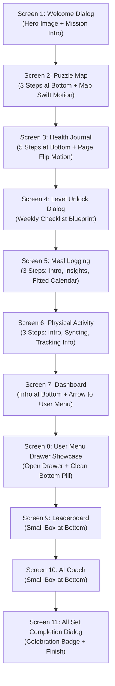

# Diabetes Prevention Program (DPP) — Interactive App Tour Walkthrough Guide

This document provides a comprehensive walkthrough reference for the interactive in-app onboarding tour implemented in DPPHealis. It covers every screen, modal, and speech bubble dialog with exact copy, design specifications, pastel color schemes, arrow directions, and target highlights.

---

## 🎨 Visual & Design System Specifications

The App Tour adheres to the app's signature **Gelato Neobrutalist** design language:
- **No Mascots**: Clean, friendly UI focusing strictly on user features and typography.
- **Bottom-Anchored Floaty Chatbox Bubbles**: Custom compact speech bubbles with 2.0px crisp black borders (`#000000`), 3.0px solid offset drop shadows (`Offset(3.0, 3.0)`), resting neatly at the bottom of the screen (`bottom: padding.bottom + 16`) so they never block or cover screen content.
- **100% Screen Visibility (No Blackout Masks)**: The entire screen stays bright and visible at all times. No heavy dark masks or cutout holes trapping elements in a box.
- **Accurately Framed Highlights**: When a specific control or metric is indicated (e.g. Insights button or Weekly Calendar), a transparent outline frame with subtle pulse animation neatly bounds the exact dimensions of the target.
- **Unobstructed User Menu Showcase**: When the User Menu drawer opens, all speech blocks and arrows are removed so the user can see the entire menu from top to bottom. A minimal floating pill at the bottom allows advancing to the Leaderboard.
- **No Slide Counter**: Does not display distracting slide count numbers (e.g. "Step X of Y") — only the dialogue, section badge, close button, Back, Next, and Skip Tour options.
- **Smooth Motions**:
  - **Puzzle Map**: Swift map glide animation showcasing map structure and level progression path.
  - **Health Journal**: Automatic page-turning swipe motion from the session video to session notes.
- **Gelato Pastel Color Palette**:
  - 🟢 **Mint Green**: `#D6E5BD` (`GelatoTheme.green`) — Dark accent: `#557A46`
  - 🟡 **Vanilla Yellow**: `#F9E1A8` (`GelatoTheme.yellow`) — Dark accent: `#D4A017`
  - 🌸 **Strawberry Pink**: `#FFCBE1` (`GelatoTheme.pink`) — Dark accent: `#D14D72`
  - 🩵 **Sky Blue**: `#BCD8EC` (`GelatoTheme.blue`) — Dark accent: `#4A90E2`
  - 🟣 **Lavender Purple**: `#DCCCEC` (`GelatoTheme.purple`) — Dark accent: `#7B68EE`
  - 🟠 **Peach Orange**: `#FFDAB4` (`GelatoTheme.orange`) — Dark accent: `#E07A5F`

---

## 🗺️ High-Level Tour Journey Flow

---

## Detailed Screen-by-Screen Walkthrough

### Phase 1: Screen 1 — Welcome Screen Modal

- **Trigger / Context**: Appears automatically on first-time user login or initial app entry, upon completing baseline assessments, or when manually launched via the User Menu ("App Tour").
- **Card Type**: Centered Modal Dialog with rounded corners (`24px`), 2.5px solid black border, 4px drop shadow.
- **Visual Asset**: Top hero illustration banner (`assets/images/diaprevent_illustration.jpg`).

| Element | Details |
| :--- | :--- |
| **Headline** | `Your Healthier Journey Starts Here! 💚` |
| **Sub-headline** | `Small steps, meaningful changes!` |
| **Body Copy** | Welcome to your Diabetes Prevention Program! This app is designed to help you build healthier habits, make informed lifestyle choices, and stay consistent with your health goals. |
| **CTA Button** | **Let's Get Started →** *(Background: Mint Green `#D6E5BD`)* |
| **Secondary Action** | **Skip Tour** *(Subtle underline link)* |

---

### Phase 2: Screen 2 — Puzzle Map

- **Screen / Route**: Home Tab (`MainShell` index `0` — `PuzzlesJourneyScreen`)
- **Number of Steps**: 3 Floaty chatbox popups
- **Display Mode**: Entire screen visible, no dark box masks. Automated swift glide motion over the puzzle map road and levels.

| Step # | ID & Section | Headline | Body Narration | Card Color | Arrow & Highlight Target |
| :---: | :--- | :--- | :--- | :---: | :--- |
| **1** | `puzzle_intro` *Puzzle Map* | **Welcome to your Puzzle Map! 🧩** | This is where your health journey unfolds. Each block represents a level that brings you one step closer to building healthier habits. | Mint Green `#D6E5BD` | **Arrow**: None **Placement**: Bottom-anchored (`0.70`) **Highlight**: Entire Screen visible |
| **2** | `puzzle_levels` *Puzzle Map* | **Your journey is divided into weekly levels!** | Complete weekly activities to unlock new levels and advance your journey! | Vanilla Yellow `#F9E1A8` | **Arrow**: None **Placement**: Bottom-anchored (`0.70`) **Highlight**: Entire Screen visible |
| **3** | `puzzle_shortcuts` *Puzzle Map* | **Your daily health activities are just a tap away!** | Use these shortcuts to quickly log your meals and record your physical activities. | Strawberry Pink `#FFCBE1` | **Arrow**: Bottom **Placement**: Top 40% **Highlight**: Transparent frame at bottom action dock |

---

### Phase 3: Screen 3 — Health Journal

- **Screen / Route**: Health Journal Tab (`MainShell` index `1` — `ManuscriptScreen`)
- **Number of Steps**: 5 Floaty chatbox popups
- **Display Mode**: Entire open book visible at all times, **all blocks kept at the bottom so they never cover the page**, no arrows.

| Step # | ID & Section | Headline | Body Narration | Card Color | Arrow & Highlight Target |
| :---: | :--- | :--- | :--- | :---: | :--- |
| **4** | `journal_intro` *Health Journal* | **Welcome to your Health Journal! 📖** | This is your weekly learning space with educational sessions and activities designed to help you make healthier choices. | Sky Blue `#BCD8EC` | **Arrow**: None **Placement**: Bottom-anchored (`0.70`) **Highlight**: Entire manuscript visible |
| **5** | `journal_video` *Health Journal* | **Start your weekly learning journey here! 🎥** | Watch your session video to learn about important topics related to healthy eating, physical activity, and diabetes prevention. | Lavender Purple `#DCCCEC` | **Arrow**: None **Placement**: Bottom-anchored (`0.70`) **Highlight**: Video player unobstructed |
| **6** | `journal_notes` *Health Journal* | **Want to revisit something you learned? 📝** | Swipe to explore your session notes and revise important tips anytime. *(Animated swiping motion)* | Vanilla Yellow `#F9E1A8` | **Arrow**: None **Placement**: Bottom-anchored (`0.70`) **Highlight**: Session Notes unobstructed |
| **7** | `journal_quiz` *Health Journal* | **Time to test what you’ve learned! 💡** | Taking your weekly quiz is essential to test your knowledge and move forward! | Mint Green `#D6E5BD` | **Arrow**: None **Placement**: Bottom-anchored (`0.70`) **Highlight**: Quiz button unobstructed |
| **8** | `journal_weigh_in` *Health Journal* | **Track your progress, one week at a time! ⚖️** | Recording your weight every week helps us track your progress over time. | Strawberry Pink `#FFCBE1` | **Arrow**: None **Placement**: Bottom-anchored (`0.70`) **Highlight**: Weigh-In card unobstructed |

---

### Phase 4: Screen 4 — Level Progression Modal Dialog

- **Trigger / Context**: Automatically shown immediately after completing Step 8 when popping back to the Puzzle screen.
- **Card Type**: Centered Modal Dialog with 2.5px solid black border, 4px shadow, and tag header.

| Element | Details |
| :--- | :--- |
| **Tag** | `Level Progression` *(Lavender Purple `#DCCCEC`)* |
| **Headline** | `Ready to Unlock Your Next Level? 🏆` |
| **Intro Text** | Your journey moves forward one week at a time. Stay consistent with your weekly activities to unlock the next milestone!  Here is what you need to do: |
| **Checklist Items** | 1. `Log your daily meals (all 5 slots)` 2. `Watch your weekly session video` 3. `Complete your session quiz` 4. `Track your physical activity & workouts` 5. `Complete your weekly weigh-in` |
| **Encouragement Callout** | `Every small effort counts. Keep going and unlock your next milestone! 💚` |
| **Controls** | **Back** (returns to Journal Step 8) • **Next: Meals →** (navigates to Meal Logging) • **Skip Tour** |

---

### Phase 5: Screen 5 — Meal Logging

- **Screen / Route**: Meal Tracking Screen (`FoodTrackingScreen`)
- **Number of Steps**: 3 Floaty chatbox popups (Insights button and Calendar properly sized)
- **Display Mode**: Entire screen visible, calendar fits cleanly within highlight frame.

| Step # | ID & Section | Headline | Body Narration | Card Color | Arrow & Highlight Target |
| :---: | :--- | :--- | :--- | :---: | :--- |
| **9** | `meals_intro` *Meal Logging* | **Welcome to your Meal Logging screen! 🥗** | Keep track of your meals, calories, and nutrition throughout the day across all five meal slots. | Strawberry Pink `#FFCBE1` | **Arrow**: None **Placement**: Bottom-anchored (`0.70`) **Highlight**: Entire Screen visible |
| **10** | `meals_insights` *Meal Logging* | **Welcome to your Insights! 💡** | Explore nutrition patterns, calorie trends, macronutrient breakdowns, and your nutrition score to make informed food choices. | Sky Blue `#BCD8EC` | **Arrow**: Top **Placement**: Top 42% **Highlight**: Transparent frame at Insights button (`top: 0.28`) |
| **11** | `meals_calendar` *Meal Logging* | **Keep an eye on your logging journey! 🟢** | Track your daily logging progress using the calendar. Green indicates all five meals logged, while orange indicates some meals logged. | Vanilla Yellow `#F9E1A8` | **Arrow**: Top **Placement**: Top 63% **Highlight**: Perfectly fitted transparent frame around entire Calendar container (`top: 0.38, height: 0.21`) |

---

### Phase 6: Screen 6 — Physical Activity

- **Screen / Route**: Activity Fitness Screen (`ActivityFitnessScreen`)
- **Number of Steps**: 3 Clean Floaty chatbox popups (Intro, Connecting & Syncing, Tracking Info)
- **Display Mode**: **No arrows, all explanations kept cleanly at the bottom**, entire screen visible.

| Step # | ID & Section | Headline | Body Narration | Card Color | Arrow & Highlight Target |
| :---: | :--- | :--- | :--- | :---: | :--- |
| **12** | `activity_intro` *Activity* | **Welcome to your Activity screen! 🏃** | This is where you can monitor your physical activity and track your progress towards your weekly fitness goals. | Peach Orange `#FFDAB4` | **Arrow**: None **Placement**: Bottom-anchored (`0.70`) **Highlight**: Entire Screen visible |
| **13** | `activity_connect_sync` *Activity* | **Connect & Sync Your Fitness Data 🔗** | Connect your Google Fit or Health Connect account to automatically sync your daily steps, active minutes, and workouts with the app. | Sky Blue `#BCD8EC` | **Arrow**: None **Placement**: Bottom-anchored (`0.70`) **Highlight**: Entire Screen visible |
| **14** | `activity_tracking_info` *Activity* | **Track Your Daily Activity 📊** | Monitor your movement, stay consistent, and work towards at least 150 minutes of moderate activity each week to prevent diabetes! | Mint Green `#D6E5BD` | **Arrow**: None **Placement**: Bottom-anchored (`0.70`) **Highlight**: Entire Screen visible |

---

### Phase 7: Screen 7 — Dashboard

- **Screen / Route**: Dashboard Tab (`MainShell` index `2` — `DashboardScreen`)
- **Number of Steps**: 2 Steps (Small intro at bottom, then arrow pointing to User Menu)

| Step # | ID & Section | Headline | Body Narration | Card Color | Arrow & Highlight Target |
| :---: | :--- | :--- | :--- | :---: | :--- |
| **15** | `dashboard_intro` *Dashboard* | **Welcome to your Dashboard! 📊** | Your personal health overview all in one place. Keep track of your weight, activity, energy balance, and daily missions! | Sky Blue `#BCD8EC` | **Arrow**: None **Placement**: Bottom-anchored (`0.70`) **Highlight**: Small size at bottom |
| **16** | `dashboard_menu` *Dashboard* | **Access your User Menu 📋** | Tap your profile icon at the top right to access assessments, weekly records, and FAQs. | Vanilla Yellow `#F9E1A8` | **Arrow**: Top **Placement**: Top 18% **Highlight**: Arrow points UP-RIGHT to User Menu profile icon |

---

### Phase 8: Screen 8 — User Menu Drawer Showcase

- **Screen / Route**: Side Drawer (`UserSideDrawer` opened smoothly via `DashboardScreen.openDrawer()`)
- **Number of Steps**: 1 Showcase step
- **Display Mode**: **Block and arrows removed so user can see the entire menu clearly**! A sleek floating pill at the bottom center lets the user continue to Leaderboard.

| Step # | ID & Section | Headline | Body Narration | Card Color | Arrow & Highlight Target |
| :---: | :--- | :--- | :--- | :---: | :--- |
| **17** | `menu_drawer_showcase` *User Menu* | **User Menu Showcase** | *(No covering block or arrows; entire drawer visible)* | Mint Green `#D6E5BD` | **Arrow**: None **Placement**: Floating pill at bottom **Controls**: `Skip` • **`Next: Leaderboard →`** |

---

### Phase 9: Screen 9 — Leaderboard

- **Screen / Route**: Leaderboard Tab (`MainShell` index `3` — `LeaderboardScreen`)
- **Number of Steps**: 1 Floaty chatbox popup (Small size at bottom)

| Step # | ID & Section | Headline | Body Narration | Card Color | Arrow & Highlight Target |
| :---: | :--- | :--- | :--- | :---: | :--- |
| **18** | `leaderboard_intro` *Leaderboard* | **Welcome to the Leaderboard! 🏆** | A little friendly competition makes your journey even more exciting! Log meals and activities to earn points and climb the ranks. | Mint Green `#D6E5BD` | **Arrow**: None **Placement**: Bottom-anchored (`0.70`) **Highlight**: Small size at bottom |

---

### Phase 10: Screen 10 — AI Coach

- **Screen / Route**: AI Coach Tab (`MainShell` index `4` — `AiChatbotScreen`)
- **Number of Steps**: 1 Floaty chatbox popup (Small size at bottom)

| Step # | ID & Section | Headline | Body Narration | Card Color | Arrow & Highlight Target |
| :---: | :--- | :--- | :--- | :---: | :--- |
| **19** | `ai_coach_intro` *AI Coach* | **Meet your AI Coach! 🤖** | Have questions about healthy eating, physical activity, or diabetes prevention? Your AI Coach is here 24/7 to help. | Lavender Purple `#DCCCEC` | **Arrow**: None **Placement**: Bottom-anchored (`0.70`) **Highlight**: Small size at bottom |

---

### Phase 11: Final Screen — Congratulations & Completion Modal

- **Trigger / Context**: Automatically appears immediately after clicking "Next" on Step 19.
- **Card Type**: Centered Modal Dialog with 2.5px solid black border and circular celebration badge.
- **Visual Asset**: Trophy Icon in Vanilla Yellow circle (`Icons.emoji_events`, size 44). No mascots.

| Element | Details |
| :--- | :--- |
| **Badge Icon** | 🏆 Gold Trophy inside Vanilla Yellow circle (`#F9E1A8`) with 2.5px border |
| **Headline** | `You're All Set! 🎉` |
| **Body Copy** | You've explored all the features of your Diabetes Prevention Program!  Now it's time to put your knowledge into action. Stay consistent, complete your weekly activities, and celebrate every little achievement along the way.  **Your journey to a healthier you starts NOW! 💚** |
| **CTA Button** | **Explore My App →** *(Mint Green `#D6E5BD` with 2px black border)* |

---

## ⚙️ Technical Architecture & Key Files

All App Tour code is cleanly decoupled in `lib/tour/`:

1. [app_tour_models.dart](file:///c:/Projects/DPPHealis/lib/tour/app_tour_models.dart): Defines `TourStep`, `TourScreenType`, and `ArrowDirection`.
2. [app_tour_steps_data.dart](file:///c:/Projects/DPPHealis/lib/tour/app_tour_steps_data.dart): Master database containing the 19 streamlined interactive tour steps with exact copy, colors, bottom positioning, and accurately framed target coordinates.
3. [chatbox_bubble.dart](file:///c:/Projects/DPPHealis/lib/tour/chatbox_bubble.dart): Speech bubble renderer with compact proportions, neobrutalist borders, shadows, close button, Back/Next controls, and zero slide-count clutter.
4. [app_tour_welcome_dialog.dart](file:///c:/Projects/DPPHealis/lib/tour/app_tour_welcome_dialog.dart): Screen 1 Welcome Modal with hero illustration and "Let's Get Started" CTA.
5. [app_tour_level_unlock_dialog.dart](file:///c:/Projects/DPPHealis/lib/tour/app_tour_level_unlock_dialog.dart): Screen 4 Weekly Checklist Modal.
6. [app_tour_completion_dialog.dart](file:///c:/Projects/DPPHealis/lib/tour/app_tour_completion_dialog.dart): Final Celebration Modal.
7. [app_tour_overlay.dart](file:///c:/Projects/DPPHealis/lib/tour/app_tour_overlay.dart): Fullscreen transparent overlay displaying bottom-anchored chatboxes, transparent highlight borders, dynamic arrow alignment, and special Drawer Showcase pill.
8. [app_tour_controller.dart](file:///c:/Projects/DPPHealis/lib/tour/app_tour_controller.dart): State manager orchestrating screen transitions, tab switching, `DashboardScreen.openDrawer()` drawer handling, automated motion triggers (map glide, journal page turns), and `SharedPreferences` persistence.
9. [user_side_drawer.dart](file:///c:/Projects/DPPHealis/lib/widgets/user_side_drawer.dart): Drawer item allowing users to replay the App Tour anytime.
